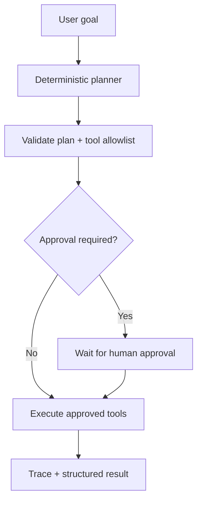

# AI Agent Workflow Automation

A local-first agentic workflow demo that converts a user goal into a small sequence of approved tool calls, validates inputs, records execution traces, and pauses for human approval before any consequential action.

**No paid model/API is required.** This reference implementation uses a deterministic planner and mocked tools so the safety and orchestration flow can be inspected and tested. It does not pretend to be an autonomous LLM agent.

## Features
- Goal-to-plan workflow with a visible execution trace.
- Tool registry with explicit allowlist and Pydantic input validation.
- Read-only tools for knowledge lookup and safe arithmetic.
- Email drafting tool that creates a draft only; it never sends email.
- Human approval gate for plans marked as consequential.
- REST API, browser UI, tests, Docker, and synthetic sample data.
- Clear failure states for unsupported tools and invalid inputs.

## Quick start
Requires Python 3.11+.

```bash
python -m venv .venv
source .venv/bin/activate  # Windows: .venv\Scripts\Activate.ps1
pip install -r requirements.txt
uvicorn app.main:app --reload
```

Open [http://127.0.0.1:8000](http://127.0.0.1:8000) or API docs at [http://127.0.0.1:8000/docs](http://127.0.0.1:8000/docs).

## Example
```bash
curl -X POST http://127.0.0.1:8000/workflows/plan \
  -H "Content-Type: application/json" \
  -d '{"goal":"Look up the maintenance restart checklist and draft an email summary"}'
```

The planner returns a plan and a run ID. Call `POST /workflows/{run_id}/execute` to run safe steps. If the plan requires approval, approve it via `POST /workflows/{run_id}/approve` before execution.

## Workflow


## API
- `GET /health` — health check
- `GET /tools` — available tools and risk labels
- `POST /workflows/plan` — create a plan
- `POST /workflows/{run_id}/approve` — approve a pending plan
- `POST /workflows/{run_id}/execute` — execute a plan
- `GET /workflows/{run_id}` — inspect status and trace

## Safety model
- Tools are allowlisted; unknown tools cannot execute.
- Arithmetic uses a constrained expression parser, not Python `eval`.
- The email tool produces a draft only.
- State is in memory and resets on restart.
- This demo is not a security boundary. Production deployments need authentication, durable audit logs, tenant isolation, rate limits, secret management, and explicit authorization at the tool boundary.

## Run tests
```bash
pytest -q
```

## Docker
```bash
docker build -t ai-agent-workflow-automation .
docker run --rm -p 8000:8000 ai-agent-workflow-automation
```

## Implemented vs. next steps
**Implemented:** deterministic plan generation, allowlisted tools, approval gate, execution trace, API/UI, tests.

**Next steps:** LangGraph-backed state persistence, optional local LLM planner via Ollama, retries/timeouts, and integrations behind explicit per-tool permissions.

## License
MIT — see [LICENSE](LICENSE).

## Explore more

- [MCP AI Developer Assistant](https://github.com/HardikPaghdar/mcp-ai-developer-assistant) — read-only repository inspection tools.
- [MCP Server Developer Toolkit](https://github.com/HardikPaghdar/mcp-server-developer-toolkit) — permission-aware tools for AI clients.
- [Multi-Agent Software Engineer](https://github.com/HardikPaghdar/multi-agent-software-engineer) — human-supervised task planning.
- [More projects on my portfolio](https://hardikpaghdar.netlify.app/).
